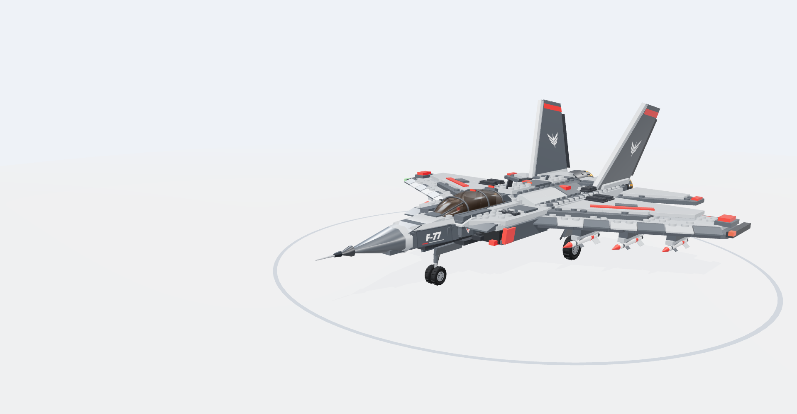
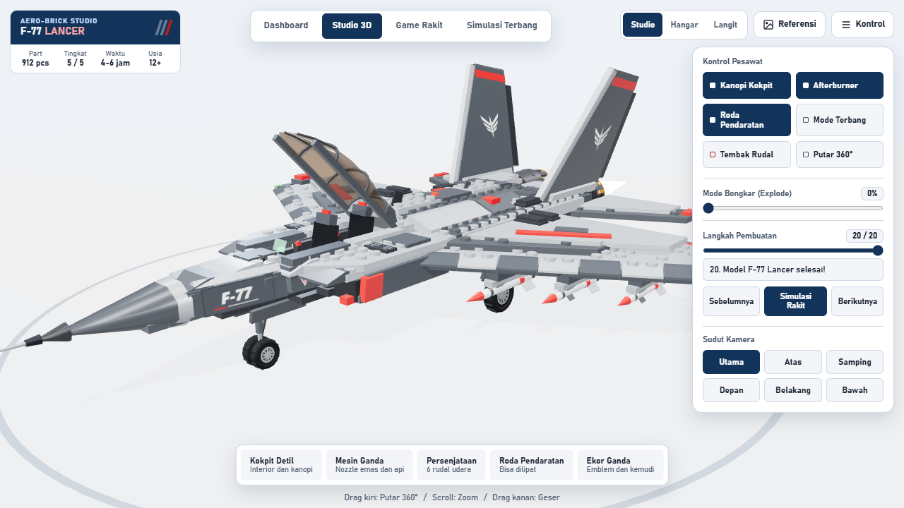
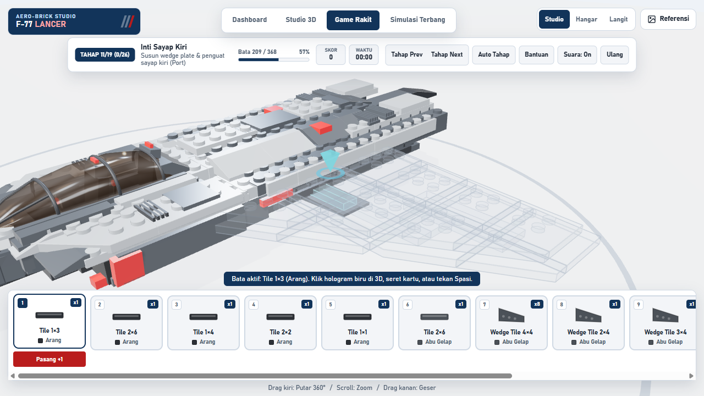
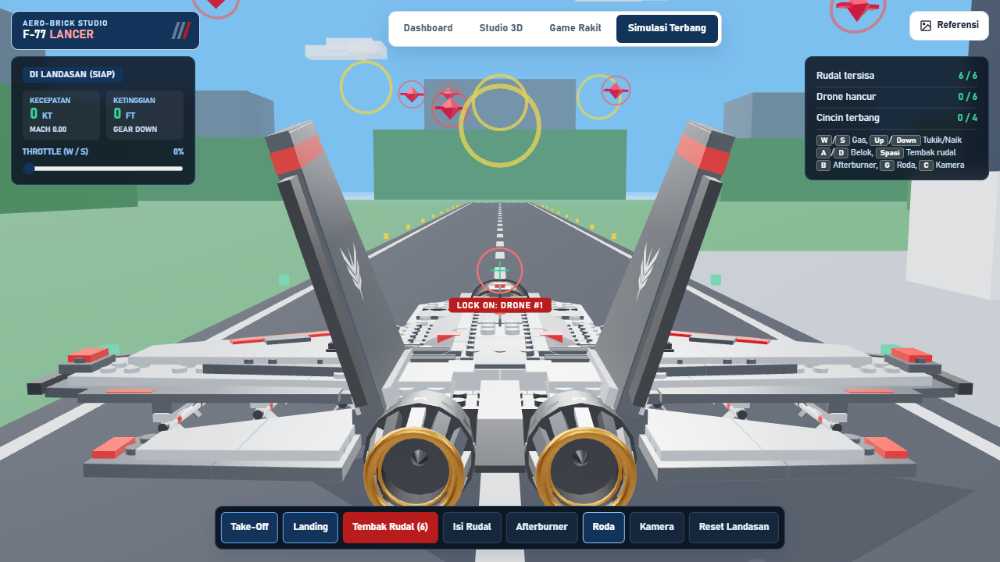

# AERO-BRICK STUDIO: LEGO F-77 Lancer 3D

An interactive WebGL web application built with **Three.js** and **Vite** that models the **LEGO F-77 Lancer Fighter Jet (912-piece reference set)** out of **360 individual standard 3D LEGO bricks**. Explore the aircraft from every angle in a 360-degree studio, assemble it brick by brick across 19 guided stages, or take off from a 3D LEGO airbase and fire homing missiles in the flight simulator.



## Application Modes

### 1. 2D Overview Dashboard
- Full-bleed frameless hero featuring a direct 3D render of the F-77 Lancer model.
- Fast startup with WebGL paused on the landing screen until entering a 3D mode.
- Direct links into each interactive mode, live application previews, and 5 model spotlight deep links (Cockpit, Twin Engines, Armament, Landing Gear, and Twin Tail).
- On-demand reference modal displaying the original set poster ([`LEGO Pesawat Tempur F-77 Lancer.png`](LEGO%20Pesawat%20Tempur%20F-77%20Lancer.png)) for side-by-side comparison.

### 2. 3D Studio (360-Degree Inspector)


- Full orbit, zoom, and pan camera controls with 11 camera presets (`Main`, `Top`, `Side`, `Front`, `Rear`, `Under`, plus 5 detail spotlights).
- Interactive aircraft animations:
  - Hinged trans-brown canopy opening over a tandem-seat cockpit with MFD console and green HUD glass.
  - Twin jet nozzles with metallic gold trim rings and flickering volumetric afterburner plumes.
  - Retractable tricycle landing gear with bay doors and treaded rubber tires.
  - 6 underwing white-and-red air-to-air missiles with salvo launch animation.
  - Flight posture demo with animated ailerons, elevators, and rudders.
- **Explode View** slider (`0%` to `100%`) and **20-Step Build Playback** (`Steps 1 to 20`).
- Three lighting environments: **Studio** (light cyclorama), **Hangar** (dark mode with grid), and **Sky** (flying through clouds).

### 3. Guided Standard-Brick Assembly Game (360 Bricks, 19 Stages)


- Decomposes the F-77 Lancer into **360 standard LEGO bricks** (`1x2`, `1x4`, `1x6`, `2x2`, `2x3`, `2x4`, `2x6` plates, bricks, tiles, slopes, grilles, wedge plates, plus dedicated components such as the canopy, engine nozzles, 6 missiles, and 3 landing gear assemblies).
- Displays an instruction-booklet **Parts List** for each stage with live remaining counts (`x8` down to `OK`) and color-matched brick SVG icons.
- Highlights all matching 3D slots in cyan with a directional beacon arrow; hovering turns a matching slot green.
- Supports three input methods:
  - Click a matching 3D hologram slot directly on the aircraft.
  - Drag and drop a part card onto a 3D slot.
  - Press number keys `1` to `9` to pick a brick and `Space` / `Enter` (or click **Pasang +1**) to snap it into place.
- Includes combo scoring, accuracy tracking, timer, hint camera focus, stage navigation (`Prev` / `Next`), `Auto Tahap` step builder, particle bursts, and procedural Web Audio LEGO click sound effects.

### 4. 3D Flight and Combat Simulator


- Playable 3D LEGO airbase world with an asphalt runway, edge lighting, spinning ATC radar tower, hangar, blocky hills, and sky clouds.
- **One-click Auto Take-Off and Auto Landing**, plus full manual flight physics (throttle, pitch, roll/yaw, afterburner, gear deployment, and touchdown detection).
- **6 homing air-to-air missiles** (with in-flight reload) that lock onto **6 patrolling target drones**, plus **4 golden waypoint rings** along the climb corridor.
- Live cockpit avionics HUD (airspeed in knots and Mach, altitude in feet, throttle, gear status, target lock reticle, and ammo/kill/ring counters).
- Three camera views: **Chase Cam**, **Cockpit Cam**, and **360-Degree Orbit Cam**.

## Controls Reference

### 3D Studio and Assembly Game

| Input | Action |
|---|---|
| Left-drag | Orbit camera 360 degrees |
| Mouse wheel / Pinch | Zoom camera in or out |
| Right-drag | Pan camera |
| `1` to `9` (Game) | Select part card 1 through 9 in the current stage |
| `Space` / `Enter` (Game) | Snap the next matching brick of the active part |
| Click / Drag part card (Game) | Place brick directly into a highlighted 3D hologram slot |
| `R` (Studio) | Reset camera to the main hero angle |
| `Escape` | Close open reference or victory dialogs |

### 3D Flight Simulator

| Input | Action |
|---|---|
| `W` / `S` | Increase or decrease throttle |
| `Arrow Down` / `Arrow Up` | Pitch nose up (climb) / pitch nose down (dive) |
| `A` / `D` or `Arrow Left` / `Arrow Right` | Bank and steer left or right |
| `Space` | Fire homing missile at locked target |
| `R` | Reload all 6 underwing missiles |
| `B` | Toggle afterburner |
| `G` | Retract or deploy landing gear |
| `C` | Cycle camera mode (Chase, Cockpit, Orbit) |

## Tech Stack

- **3D Engine**: [Three.js](https://threejs.org/) (`^0.174.0`) with PMREM `RoomEnvironment`, PBR ABS plastic materials, procedural canvas decals (`F-77`, caution triangle, winged-eagle tail emblem, cockpit MFD), and merged per-brick `BufferGeometry` caching.
- **Bundler and Dev Server**: [Vite](https://vite.dev/) (`^6.2.0`) with ES module asset imports.
- **Audio**: Zero-dependency procedural Web Audio API synthesizer (`src/game/sound.js`) for LEGO plastic snap clicks, combo chimes, gear hydraulics, missile ignition, explosions, and runway touchdown.
- **UI and Accessibility**: Vanilla HTML5 and CSS3 with semantic landmarks, skip link, keyboard focus trap on modals, WCAG AA contrast across light/dark/HUD surfaces, and responsive layouts across desktop, tablet, and mobile breakpoints.

## Project Structure

```text
LegoPlan/
├── index.html                           # Application shell (Dashboard, Studio, Game, Flight HUDs)
├── package.json                         # Scripts and dependencies (Three.js + Vite)
├── vite.config.js                       # Vite configuration
├── LEGO Pesawat Tempur F-77 Lancer.png  # Original reference poster for comparison modal
└── src/
    ├── main.js                          # Mode routing, UI bindings, keyboard/drag controllers, render loop
    ├── scene.js                         # Three.js scene, lighting, PMREM reflections, camera presets, environments
    ├── styles.css                       # Design tokens, responsive layouts, themes, HUDs, modals
    ├── assets/                          # Direct 3D renders captured from the application
    │   ├── hero-f77-render.png
    │   ├── preview-flight.png
    │   ├── preview-game.png
    │   └── preview-studio.png
    ├── lego/
    │   ├── bricks.js                    # Standard LEGO brick factory, stud merger, and polygon wedge slicer
    │   └── materials.js                 # LEGO ABS PBR material palette and procedural canvas decals
    ├── model/
    │   ├── f77Lancer.js                 # Master F-77 Lancer assembly, 20 build steps, rest pose, animations
    │   ├── fuselage.js                  # Chassis, spine, nose cone, pitot probe, F-77 decals, air intakes
    │   ├── cockpit.js                   # Tandem seats, MFD dashboard, HUD, consoles, hinged trans-brown canopy
    │   ├── wings.js                     # Swept delta wings, leading-edge slopes, red trim, hinged ailerons
    │   ├── tailAndEngines.js            # Twin gold-ringed nozzles, afterburners, canted twin tails, antennas
    │   └── weaponsAndGear.js            # 6 underwing missiles, pylons, retractable tricycle landing gear
    ├── game/
    │   ├── assemblyGame.js              # 19-stage guided brick assembly logic, raycasting, scoring, holograms
    │   ├── particles.js                 # 3D brick snap bursts and victory confetti system
    │   └── sound.js                     # Procedural Web Audio API sound effects
    └── sim/
        └── flightSim.js                 # 3D airbase world, flight physics, auto take-off/landing, homing missiles
```

## Getting Started

### Prerequisites
- [Node.js](https://nodejs.org/) v18 or later (tested on Node v24.20.0)
- A modern browser with WebGL enabled

### Installation and Local Development

```bash
git clone https://github.com/ihyaabrar/LegoPlan.git
cd LegoPlan
npm install
npm run dev
```

Open `http://localhost:5173/` in your browser.

### Production Build and Preview

```bash
npm run build
npm run preview
```

## URL Query Shortcuts

For quick testing or direct links into specific modes:
- `/?mode=studio` opens the 3D Studio directly.
- `/?mode=game&step=11` opens the Assembly Game directly at Stage 11 (`1` to `19`).
- `/?mode=flight` opens the 3D Flight Simulator on the runway (`&air=1` starts airborne).
